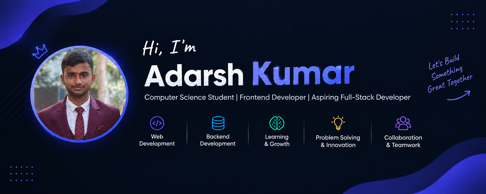

<h1 align="center">Hey there, I'm Adarsh Kumar 👋</h1>

<h3 align="center">💻 Computer Science Student | Frontend Developer | Aspiring Full-Stack Developer</h3>

  
  

  

---

## 🚀 About Me

- 🎓 B.Tech Computer Science and Engineering student.
- 🌱 Currently learning **Backend Development, REST APIs, and SQL**.
- 💻 Interested in building practical and user-friendly web applications.
- 🤝 Open to collaborating on **full-stack projects**.
- 💬 Ask me about **Python, C++, HTML, CSS, JavaScript, Bootstrap, Node.js, Express.js, and EJS**.
- 📫 Email: **[adarshrajputji55@gmail.com](mailto:adarshrajputji55@gmail.com)**

---

## 🧰 Languages and Tools

  

---

## 🌟 Featured Projects

<table>
  <tr>
    <td width="50%" valign="top">
      <h3>🌦️ Weather Dashboard</h3>
      
A weather dashboard project and my first step into building interactive web applications.

      
    </td>
    <td width="50%" valign="top">
      <h3>📊 Instrument Verification Dashboard</h3>
      
A dashboard project focused on presenting instrument verification information in an organized interface.

      
    </td>
  </tr>
</table>

  

---

---

## 💻 Most Used Languages

  

---

## 🤝 Connect With Me

  
  
  

  💬 Have an idea for a project? Let's build something useful together!

  <b>⭐ Thanks for visiting my profile!</b> 
  <i>Keep learning. Keep building. Keep growing. 🚀</i>

